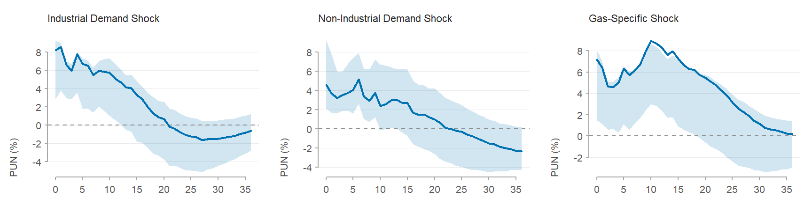

# A Structural VAR Analysis for the Italian Electricity Market

MSc thesis in Data Science for Economics, Università degli Studi di Milano,
academic year 2025/26. Supervisor: Prof. Andrea Bastianin. Co-supervisor:
Prof. Luca Rossini.

**[Slides](docs/presentation.pdf) · [Full report](https://alessandro-macchi.github.io/Italian-Electricity-SVAR/main.html)**

Italy generates close to half of its electricity from natural gas, so shocks in
the European gas market reach households and firms through the PUN (*Prezzo
Unico Nazionale*), the Italian wholesale reference price. This project
estimates a structural VAR on monthly data from 2006 to 2025 with four
endogenous variables (the PUN, the TTF gas price, electricity consumption and
industrial production) and renewable installed capacity as an exogenous
regressor. Sign restrictions on impact separate three structural shocks:
industrial demand, non-industrial demand and gas-specific. The restrictions fix
only the direction of each response; its size, persistence and share of
variance are left to the data. The identified model is used for impulse
responses, variance and historical decompositions, and conditional forecasts
up to the end of 2027.

## Main findings

- **Gas shocks pass through strongly and persistently.** A one-standard-deviation
  gas-specific shock raises the PUN by 7.2% on impact and by 8.9% at its peak,
  and the effect stays significant for 18 months. On impact, prices respond
  up to six times more than quantities.
- **Gas drives the PUN in the long run.** Industrial demand explains about half
  of the PUN's forecast error variance one month ahead, but at one and two
  years the gas-specific shock is the largest source (45% and 48%).
- **The same gas price can mean opposite things.** If TTF is held at its August
  2026 level, industrial production changes by −7.4 log points on average over
  January–August 2027 when the price reflects gas scarcity, and by +8.3 when it
  reflects stronger industrial demand. The bands exclude zero in both cases.



*Response of the PUN (%) to each identified shock, 0–36 months. Line:
median-target model; band: 68% bootstrap band.*

## Method

- Reduced-form VAR with 12 lags in log levels, 11 monthly dummies and RES
  installed capacity as an exogenous regressor.
- Identification by sign restrictions on impact. 300,000 random (Haar-uniform)
  rotations of the Cholesky factor are screened against the table below, and
  about 0.2% pass. The reported model is the Fry and Pagan (2011) median
  target: the admissible model closest to the pointwise median.
- Inference by a residual bootstrap with 2,000 replications. Each replication
  rebuilds the sample, re-estimates the VAR and re-runs the whole sign search
  (Kilian and Lütkepohl, 2017).

| Response of            | Industrial demand | Non-industrial demand | Gas-specific | Unlabelled |
|------------------------|:-----------------:|:---------------------:|:------------:|:----------:|
| Electricity price      | +                 | +                     | +            | free       |
| Gas price              | +                 | +                     | +            | free       |
| Electricity consumption| +                 | +                     | −            | free       |
| Industrial production  | +                 | −                     | −            | free       |

## Reproduce

Tested with R 4.3.0 and `vars` 1.6.1, `urca` 1.3.4, `tseries` 0.10.58,
`purrr` 1.0.4, `tibble` 3.2.1, `dplyr` 1.1.4, `readr` 2.1.5, `lubridate` 1.9.4,
`knitr` 1.49 and `rmarkdown` 2.29.

```r
install.packages(c("vars", "urca", "tseries", "purrr", "tibble", "dplyr",
                   "readr", "lubridate", "knitr", "rmarkdown"))
rmarkdown::render("main.Rmd")
```

Rendering writes `main.html` and saves every estimate to
`output/svar_results.rds`. Seeds are fixed in `R/00_config.R`, so a re-run
reproduces the reported numbers. The main sign search takes under a minute,
and the bootstrap about 30 minutes on a laptop (0.9 s per replication). For a
quick run, lower `config$bootstrap$n_boot`.

## Repository structure

| Path | Contents |
|------|----------|
| `R/00_config.R` | Every modelling choice: variables, transforms, lags, sign restrictions, bootstrap and scenario settings |
| `R/01_load_data.R` | Reads each raw CSV with its own format and aligns all series on one monthly grid |
| `R/02_transform.R` | Level, log, difference and log-difference transforms |
| `R/03_sanity_checks.R` | Unit-root (ADF, KPSS) and Johansen cointegration tests |
| `R/04_var_model.R` | Reduced-form VAR, lag selection, residual and stability diagnostics |
| `R/05_sign_restrictions.R` | Random rotations, sign checks, median-target selection |
| `R/06_bootstrap.R` | Residual bootstrap with the full sign search in every replication |
| `R/07_fevd.R` | Forecast error variance decomposition |
| `R/08_historical_decomposition.R` | Historical decomposition |
| `R/09_conditional_forecast.R` | Conditional forecasts: the March 2026 gas shock, constant gas price, escalation stress test |
| `main.Rmd`, `main.html` | Report that runs every step above, and its rendered copy |
| `data/raw/` | Input series (see [Data](#data)) |
| `output/svar_results.rds` | Saved estimates |
| `docs/` | Slides and the README figure |

## Data

Monthly series, February 2005 to December 2025 for estimation and up to August
2026 for the conditional forecasts.

| File | Series | Source | Reuse terms |
|------|--------|--------|-------------|
| `pun.csv` | PUN, monthly average of daily values (EUR/MWh) | [GME](https://www.mercatoelettrico.org) | Aggregate market data are public; non-commercial reuse citing "Fonte: GME" |
| `energy_consumption.csv` | National electricity demand, *fabbisogno nazionale* (MWh) | [GME](https://www.mercatoelettrico.org) | As above |
| `ttf.csv` | TTF day-ahead close, monthly average (EUR/MWh) | LSEG Workspace (Refinitiv) | Proprietary. Not included: export it with your own LSEG access into `data/raw/ttf.csv` (columns `Date`, `month_start`, `Price`, `n_obs`) |
| `ita_ipi.csv` | Industrial production index, NACE B–D, calendar adjusted, 2021 = 100 | [Eurostat](https://ec.europa.eu/eurostat) | Reuse allowed with the source acknowledged |
| `ita_res_capacity.csv` | Renewable installed capacity (MW), annual data interpolated to monthly by the author | [IRENA](https://www.irena.org/Data) | Reuse allowed with attribution (© IRENA) |

The data are not covered by the code's MIT licence; they remain under their
providers' terms.

## Changing the model

Every choice lives in `R/00_config.R`. The other modules loop over the config
and need no edits.

- **Add a variable:** append one block to `config$variables` (file, date column
  and format, delimiter, decimal mark, label, transform, role). The loader
  aligns it on the monthly grid, and missing months become `NA`.
- **Transform:** set `transform` to `"level"`, `"log"`, `"diff"` or `"logdiff"`.
- **Endogenous or exogenous:** set `role`. Exogenous series enter
  `vars::VAR(exogen = ...)` together with the monthly dummies.
- **Lag order:** `config$lag_selection$method` is `"fixed"` (uses `p_fixed`) or
  `"auto"` (uses `vars::VARselect()` with `criterion` set to AIC, HQ, SC or FPE).
- **Sign restrictions:** `config$shocks` has one entry per shock, mapping each
  restricted variable to a sign and the horizons it applies to (0 = impact).
  If tighter restrictions give "No admissible rotations found", loosen them or
  raise `config$identification$n_draws`.
- **Inference and scenarios:** `config$bootstrap` sets the replications,
  rotations per replication and band level; `config$fevd$horizons` and
  `config$cf` set the FEVD horizons and the scenario dates.

Main methodological references: Kilian, L. and Lütkepohl, H. (2017),
*Structural Vector Autoregressive Analysis*, Cambridge University Press;
Fry, R. and Pagan, A. (2011), "Sign restrictions in structural vector
autoregressions: a critical review", *Journal of Economic Literature* 49(4).

## License

Code: [MIT](LICENSE). Data: see [Data](#data).
